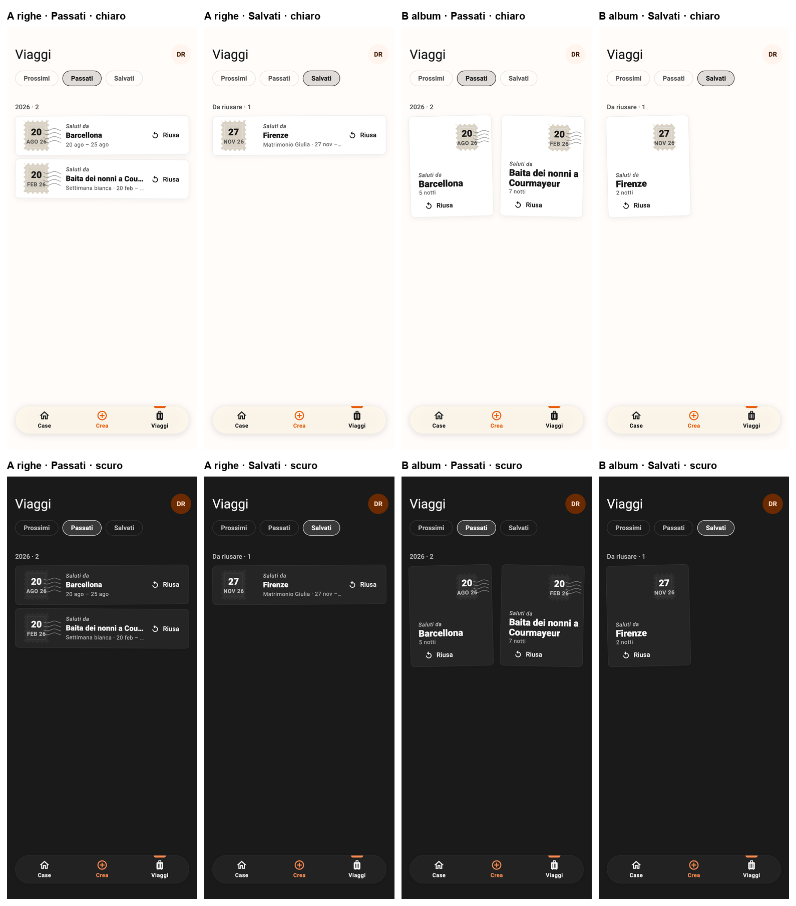
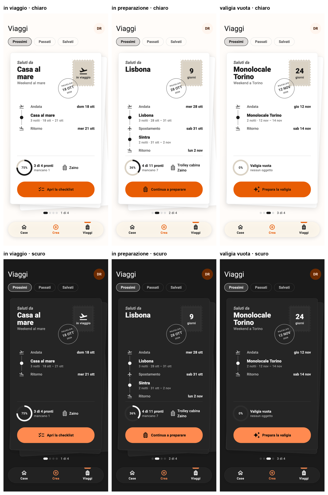
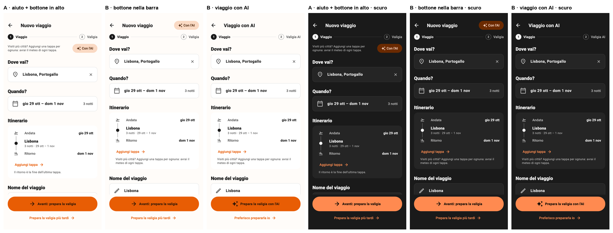
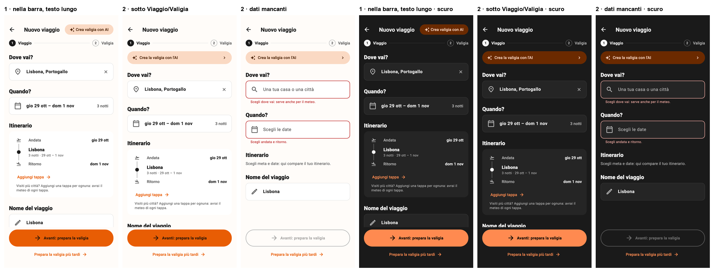
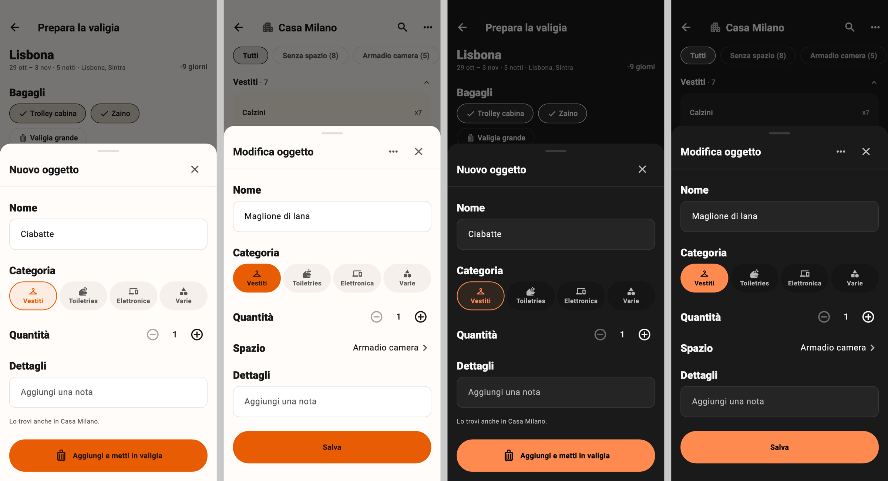

# Decisioni aperte e alternative tenute da parte

Scelte di design già prese ma su cui potremmo tornare, con l'alternativa scartata a portata di mano. Le immagini stanno in `docs/superpowers/mock/`. Questa cartella è locale (`docs/` è in `.gitignore`).

## Viaggi · Passati e Salvati (19/10/2026)

**Scelta per ora: B, album.** Cartoline piccole, due per riga, appese un po' storte; francobollo con la data in alto a destra, "Saluti da" e meta in basso, "Riusa".

**Alternativa tenuta da parte: A, righe a mini cartolina.** Viene dal mini biglietto di V1: francobollo con giorno e mese al posto della matrice, "Saluti da", meta, nome e date, "Riusa" a destra. Righe leggermente storte e alternate. Più compatta e veloce da leggere quando i viaggi sono tanti.

In entrambe: i passati hanno il francobollo "annullato" dalle onde del timbro postale, i salvati no; passati raggruppati per anno, salvati sotto "Da riusare"; "Riusa" neutro (l'arancio resta solo sul bottone della cartolina dei prossimi).

## Viaggi · Card dei prossimi viaggi (18-19/10/2026)

**Scelta: cartolina con itinerario.** Pila di cartoline: quella in cima è sempre dritta (anche il bottone), quelle sotto sono solo carta un po' storta; si scarta da destra a sinistra e si riprende al contrario. "Saluti da" + meta, francobollo con i giorni (o "in viaggio") e timbro con la data di partenza; itinerario verticale Andata → luoghi (notti e periodo) → Spostamento → … → Ritorno, senza "oggi" né luogo di partenza; in fondo una riga con l'anello di riempimento ("4 di 11 pronti · mancano 7") e accanto i bagagli scelti (se ce ne sono); bottone arancio contestuale. Indicatore "1 di N" più staccato dalla card e dalla barra di navigazione.

Correzioni del 19/10 rispetto alla prima versione (`cartolina-con-itinerario-prima-versione.png`): cartolina dritta; tolto il messaggio scritto a mano ("Ho già messo in valigia…") e la riga Bagagli, sostituiti dall'anello con i bagagli sulla stessa riga; più spazio intorno all'indicatore.

Varianti esplorate, nel caso servisse riprendere qualche pezzo:

| Variante | Cosa piaceva | Immagine |
|---|---|---|
| V1 carta d'imbarco | riga PARTENZA ✈ RITORNO orizzontale con date grandi | `card-v1-v2-chiaro.png`, `card-v1-v2-scuro.png` |
| V2 conto alla rovescia | anello di riempimento; testata "9 giorni ┊ Lisbona" con staccato | come sopra |
| V3 etichetta, V4 agenda, V5 copertina | V3: fascia in alto (ma foro e icona sembravano tick e bottone); V5 abbastanza coerente | `card-v3-v5-chiaro.png` |
| V6 valigia, V7 cartoline, V8 rotta | **V7 scelta**; V8 ha fatto nascere l'idea dell'itinerario verticale | `card-v6-v8-chiaro.png` |
| V9 metro, V10 passaporto, V11 cartolina d'epoca | itinerario Andata → tappe → Ritorno | `card-v9-v11-chiaro.png` |

Il codice del mock (usa e getta) è in `mock/viaggi/trips_mock.dart.txt` e `mock/viaggi/mock_trips_test.dart.txt`: si rigenera in una copia del repo con `--dart-define=MOCK_TRIPS=v1…v12b`.

Rimandati ai dati (da vedere con il nuovo viaggio): luogo di partenza ("Parti da"), mezzo per ogni tratto (oggi l'aereo è un simbolo generico), foto del posto.

## Viaggi · Nuovo viaggio, passo 1 (20/10/2026)

**Scelta:** flusso Viaggio → Valigia; il viaggio si salva alla fine del passo 1. Tappe con date in catena (ognuna parte dove finisce la precedente), ritorno automatico, "Quando?" sempre uguale, aiuto "Visiti più città? … avrai il meteo di ogni tappa" vicino ad "Aggiungi tappa". Bottone AI sottile a tutta larghezza **sotto l'indicatore dei passi** (variante "2").

**Alternative tenute da parte:**
- bottone "Crea valigia con AI" nella barra in alto accanto al titolo: si legge, ma al limite con schermi stretti o testo ingrandito;
- aiuto e bottone sulla stessa riga in alto (variante A): sembrano legati;
- card AI grande in cima: troppo invasiva.

## Oggetti · Scheda oggetto unica (20/10/2026)

**Scelta:** una sola scheda per creare e modificare un oggetto (tocco nella casa, "Aggiungi «nome»" dalla pagina valigia, più avanti "Modifica" nei risultati AI). Nome in un campo, 4 categorie su una riga con le stesse `CategoryPill` della pagina "Aggiungi", quantità con lo stepper neutro sulla stessa riga dell'etichetta, spazio solo se la casa ne ha, sezione "Dettagli" (per ora solo la nota). Il rapid fire resta per inserire tanti oggetti di fila.

**Da ricordare:** nella modifica la categoria scelta è la pillola piena arancio, quindi nella scheda ci sono due arancioni (pillola e "Salva"). Lasciata così per coerenza con la pagina "Aggiungi" (piena = scelta tua, bordata = proposta). Se si vuole l'arancio solo sui bottoni, va cambiata la `CategoryPill` ovunque, non solo nella scheda.

**Passo 2 (dopo):** "Modifica" nei risultati AI apre la stessa scheda; in "Dettagli" compaiono le pillole dei metadati AI (tipo, colore, calore, usi…) modificabili con la lista dei valori ammessi, più la nota libera. Per l'utente è una sezione sola; sotto restano separati (`aiMetadata` letto dal generatore, `description` testo libero). Un dettaglio corretto dall'utente va segnato come suo, così l'arricchimento GPT/Jev non lo sovrascrive. Le liste di valori devono essere quelle che capisce il generatore.

## Da fare più avanti

- **Bagagli:** oggi vivono a sé dentro la casa e il redesign non li ha ancora toccati (peso, capienza, scelta nel viaggio). Da riprendere in futuro, non ora (richiesta dell'utente, 19/10/2026).
- **Scansione AI, "aggiungi dettagli" a un oggetto già salvato** (`already_here_sheet.dart`, azione mostrata quando `item.aiMetadata == null`): quando anche le aggiunte a mano passeranno da GPT/Jev (lavoro in un'altra sessione), ogni oggetto avrà già i metadati e quest'azione non servirà più. Da togliere dopo l'arricchimento delle aggiunte manuali (richiesta dell'utente, 20/10/2026).
- **Dalla tab Viaggi a cartoline (20/10/2026), piccole cose rimaste:** la "Copia viaggio" del menu non copia le tappe (comportamento vecchio); una trentina di chiavi dei dizionari `trips.*` non sono più usate da nessuno; "Riusa" ha un'area di tocco piccola nella cartolina dell'album; con il testo di sistema ingrandito la cartolina dell'album potrebbe stringere; filtri della tab centrati (il mock li aveva a sinistra).

## Da riallineare al nuovo design

Parti dell'app ancora con il disegno vecchio (arancio fuori posto, snackbar, densità, componenti non del kit). Lista tenuta aggiornata su richiesta dell'utente (20/10/2026); si spunta quando un pezzo viene rifatto.

**Già riallineati:** navigazione e foglio Crea; dettaglio casa (lista, ricerca, pagina Aggiungi, scheda oggetto, selezione); risultati della scansione AI; tab Viaggi a cartoline; nuovo viaggio passo 1 e pagina valigia (PR del 20-21/10, al posto del vecchio wizard e di "Modifica oggetti"); scheda oggetto unica per creare e modificare, con l'aggiunta dalla ricerca della valigia (branch `feat/scheda-oggetto-unica`).

**Prossimo:** meteo nella pagina valigia (riepilogo per tappa, giorni, fasce orarie) con la discussione sulla gestione delle chiamate.

**Da fare:**
- **Viaggi · Dettaglio viaggio** (`trip_detail_screen.dart`): intestazione, filtri con "Tutto" arancio, checklist, barra in basso con i bottoni tondi, dialogo "Elimina lista".
- **Link e CTA degli stati vuoti arancio** (`DsLinkButton`, `DsEmptyState`): sono rimasti arancio come da design system; se si vuole l'arancio solo sui bottoni principali va deciso a livello di tema.
- **Oggetti · Modifica dai risultati AI** (`ai_result_card.dart`): "Modifica" deve aprire la scheda oggetto unica, con i dettagli AI in "Dettagli" (passo 2, vedi sopra).
- **Viaggi · Modifica informazioni** (`edit_trip_info_screen.dart`, `trip_info_form.dart`, `TripLegsSection` e il foglio tappa vecchio): va portata sul modello del passo 1, con tappe in catena e ricerca unica.
- **Viaggi · Scelta di un viaggio** dalla selezione nella casa (`trip_picker_sheet.dart`): da verificare.
- **Case · Modulo casa** (`add_edit_house_screen.dart`, `house_form_content.dart`), con la località obbligatoria che segnala l'errore con uno snackbar.
- **Case · Gestione spazi** (`spaces_management_screen.dart`, `add_edit_space_screen.dart`) e foglio di gestione della casa (`house_manage_sheet.dart`): da verificare.
- **Bagagli** (`luggages_management_screen.dart`, `add_edit_luggage_screen.dart`): da rifare insieme al tema peso e capienza.
- **Profilo** (`profile_screen.dart` e i suoi dialoghi).
- **Accesso e primo avvio:** login, onboarding, introduzione all'AI (`login_screen.dart`, `onboarding_screen.dart`, `ai_onboarding_intro_screen.dart`).

## Case · Dettaglio casa (17/10/2026)

**Scelta: gruppi su blocchi tonali arrotondati** (PR #32, decisione dell'utente dopo la prova sull'app). Alternativa: lista piatta con etichette fisse in alto (spec flusso A, prima versione).

## Tema

- Cursore dei campi di testo arancio (anche nella ricerca della casa): decidere se renderlo neutro, ma nel tema per tutta l'app, non come eccezione.
